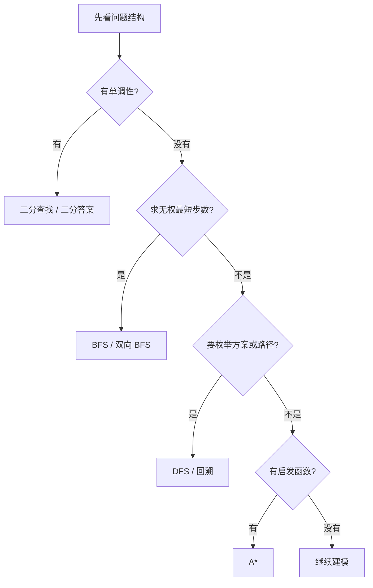

# 搜索算法

> [!summary] 搜索题不要一上来就写代码，先判断你的搜索空间是什么形状，再决定用二分、DFS、BFS 还是回溯。

## 怎么选搜索算法



很多题难，不是难在实现，而是第一步选错了搜索模型。

## 四个核心方向

### 二分查找

- 适合有序数组、单调答案、边界定位。
- 代表内容：
  - [[二分查找/标准二分查找|标准二分查找]]
  - [[二分查找/左边界查找|左边界查找]]
  - [[二分查找/右边界查找|右边界查找]]
  - [[二分查找/旋转数组搜索|旋转数组搜索]]

### DFS

- 适合连通性、路径存在性、递归遍历。
- 代表内容：
  - [[深度优先搜索/DFS基础模板|DFS 基础模板]]
  - [[深度优先搜索/岛屿问题|岛屿问题]]

### BFS

- 适合无权最短路、层序扩散、最少步数。
- 代表内容：
  - [[广度优先搜索/BFS基础模板|BFS 基础模板]]
  - [[高级搜索/双向BFS|双向 BFS]]

### 回溯

- 适合组合枚举、约束搜索、需要撤销状态的场景。
- 代表内容：
  - [[回溯算法/回溯框架|回溯框架]]
  - [[../回溯算法/_index|回溯算法总览]]

## 高频 Go 模板

### 二分查找

```go
func binarySearch(nums []int, target int) int {
	left, right := 0, len(nums)-1
	for left <= right {
		mid := left + (right-left)/2
		if nums[mid] == target {
			return mid
		}
		if nums[mid] < target {
			left = mid + 1
		} else {
			right = mid - 1
		}
	}
	return -1
}
```

二分真正要守住的是区间定义。你写的是 `[left, right]`，还是 `[left, right)`，全程必须一致。

### BFS 最短步数

```go
type State struct {
	x, y int
	step int
}

func bfs(grid [][]int, sx, sy int) int {
	m, n := len(grid), len(grid[0])
	vis := make([][]bool, m)
	for i := range vis {
		vis[i] = make([]bool, n)
	}

	q := []State{{sx, sy, 0}}
	vis[sx][sy] = true
	dirs := [][2]int{{1, 0}, {-1, 0}, {0, 1}, {0, -1}}

	for len(q) > 0 {
		cur := q[0]
		q = q[1:]

		if isTarget(cur.x, cur.y) {
			return cur.step
		}

		for _, d := range dirs {
			nx, ny := cur.x+d[0], cur.y+d[1]
			if nx < 0 || nx >= m || ny < 0 || ny >= n {
				continue
			}
			if vis[nx][ny] || grid[nx][ny] == 1 {
				continue
			}
			vis[nx][ny] = true
			q = append(q, State{nx, ny, cur.step + 1})
		}
	}

	return -1
}
```

只要题目在问“最少几步”，默认先怀疑是不是 BFS。

### DFS 遍历

```go
func dfs(grid [][]byte, i, j int) {
	if i < 0 || i >= len(grid) || j < 0 || j >= len(grid[0]) {
		return
	}
	if grid[i][j] != '1' {
		return
	}

	grid[i][j] = '0'
	dfs(grid, i+1, j)
	dfs(grid, i-1, j)
	dfs(grid, i, j+1)
	dfs(grid, i, j-1)
}
```

DFS 最适合做“把一整块连通区域一次性吃掉”。

## 常见易错点

> [!warning] 搜索题最容易翻车的不是写不出来，而是边界、访问标记和状态定义不稳定。

- 二分查找里最常见的是区间开闭不统一。
- BFS 里最常见的是入队时不标记，导致重复入队。
- DFS / 回溯里最常见的是状态没恢复，或者终止条件放错位置。
- 图搜索里如果状态不仅仅是坐标，还要把钥匙、方向、步数限制一并放进状态。

## 刷题顺序

1. 先刷二分查找，把边界写稳。
2. 再刷 DFS 和 BFS，区分“找连通块”和“找最短路”。
3. 最后做双向 BFS、A*、记忆化搜索这些进阶题。

## 相关主题

- [[../树算法/_index|树算法]]
- [[../图算法/_index|图算法]]
- [[../动态规划/_index|动态规划]]
- [[../贪心算法/_index|贪心算法]]

---
返回：[[../算法学习导航|算法学习导航]]
