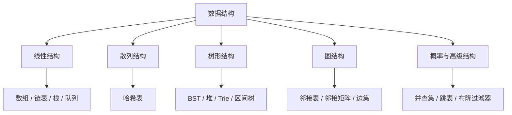

# 数据结构

> [!summary] 数据结构不是孤立记忆的名词表，而是“我该怎样存数据，才能让某个操作更快”的答案集合。

## 怎么选数据结构

可以先问自己四个问题：

1. 我最常做的操作是什么，是查、改、删，还是维护最值。
2. 数据是顺序关系更重要，还是映射关系更重要。
3. 我需要有序，还是只要够快。
4. 这是静态数据，还是会频繁更新。

## 核心主题

### 线性结构

#### [[数组|数组（Array）]]
- 强项：随机访问、原地修改、双指针
- 高频套路：滑动窗口、前缀和、区间扫描

#### [[链表|链表（Linked List）]]
- 强项：插入删除灵活
- 高频套路：快慢指针、虚拟头节点、反转与重连

#### [[栈|栈（Stack）]]
- 强项：处理“最近进入的信息”
- 高频套路：括号匹配、表达式求值、单调栈

#### [[队列|队列（Queue）]]
- 强项：处理“最早进入的信息”
- 高频套路：BFS、滑动窗口、任务调度

### 散列结构

#### [[哈希表|哈希表（Hash Table）]]
- 强项：映射、去重、计数
- 高频套路：把 `O(n^2)` 枚举压成 `O(n)`

### 树形结构

#### [[二叉树|二叉树（Binary Tree）]]
- 强项：递归结构清晰
- 高频套路：遍历、路径、构造、子树信息汇总

#### [[二叉搜索树|二叉搜索树（BST）]]
- 强项：天然有序
- 高频套路：查找、验证、第 k 小、最近公共祖先

#### [[平衡二叉树|平衡二叉树（AVL Tree）]]
- 强项：严格控制树高
- 重点：理解旋转思想即可

#### [[红黑树|红黑树（Red-Black Tree）]]
- 强项：工程里更常见的平衡树方案
- 重点：理解平衡约束，不必死背全部证明

#### [[堆|堆（Heap）]]
- 强项：动态维护最值
- 高频套路：Top K、优先队列、中位数

#### [[Trie树|Trie树（前缀树）]]
- 强项：前缀查询
- 高频套路：字典树匹配、单词搜索、自动补全

#### [[线段树|线段树（Segment Tree）]]
- 强项：动态区间查询与修改
- 重点：节点表示什么、懒标记何时下传

#### [[树状数组|树状数组（Fenwick Tree）]]
- 强项：前缀统计
- 高频套路：逆序对、动态前缀和

### 图结构

- 详见 [[../图算法/_index|图算法]]
- 核心区别：邻接矩阵适合稠密图，邻接表适合稀疏图

### 高级数据结构

#### [[并查集|并查集（Union-Find）]]
- 强项：动态维护连通性
- 高频套路：连通块、合并集合、Kruskal

#### [[跳表|跳表（Skip List）]]
- 强项：有序集合
- 重点：把链表查找通过多层索引加速

#### [[布隆过滤器|布隆过滤器（Bloom Filter）]]
- 强项：超低内存做存在性判断
- 代价：可能误判存在，但不会误判不存在

#### [[稀疏表|稀疏表（Sparse Table）]]
- 强项：静态 RMQ
- 适合：查很多次，几乎不修改

## 一张表看常用结构

| 场景 | 优先考虑 |
|------|----------|
| 高频随机访问 | [[数组]] |
| 高频插入删除 | [[链表]] |
| 最近匹配 / 括号 / 单调关系 | [[栈]] |
| 分层遍历 / 最短步数 | [[队列]] |
| 映射 / 去重 / 计数 | [[哈希表]] |
| 维护动态最值 | [[堆]] |
| 有序查找 | [[二叉搜索树]] |
| 连通性合并 | [[并查集]] |
| 前缀匹配 | [[Trie树]] |
| 区间查询修改 | [[线段树]] / [[树状数组]] |

## 学习顺序

1. 先打牢 [[数组]]、[[链表]]、[[栈]]、[[队列]]。
2. 再补 [[哈希表]] 和 [[堆]]，把最常见的面试结构吃透。
3. 然后进入 [[二叉树]]、[[二叉搜索树]]、[[Trie树]]。
4. 最后看 [[并查集]]、[[线段树]]、[[树状数组]] 这些专题结构。

## 学习时要盯住什么

- 它解决的是哪类慢操作。
- 它牺牲了什么来换速度。
- 它最常和哪些算法套路组合出现。
- 它的边界和实现最容易错在哪里。

## 相关主题

- [[../树算法/_index|树算法]]
- [[../图算法/_index|图算法]]
- [[../算法模板/_index|算法模板]]

---
返回：[[../算法学习导航|算法学习导航]]
