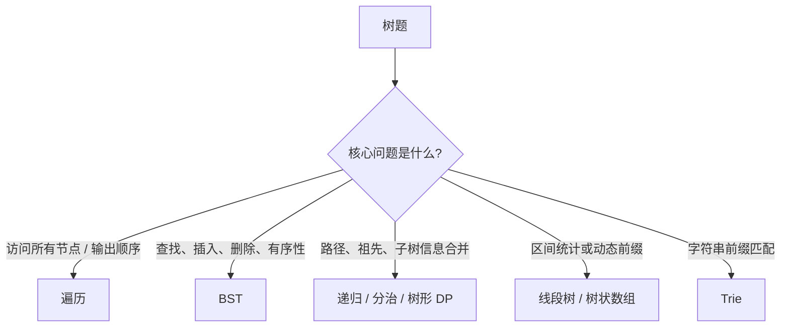
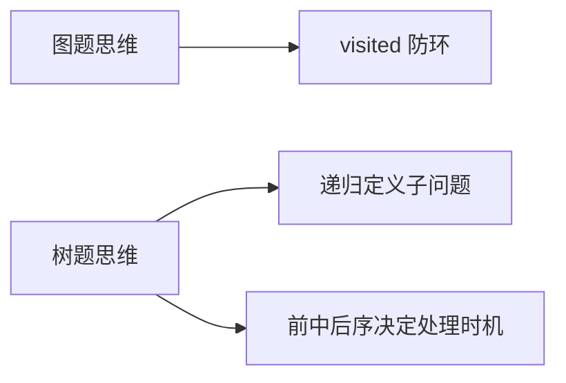
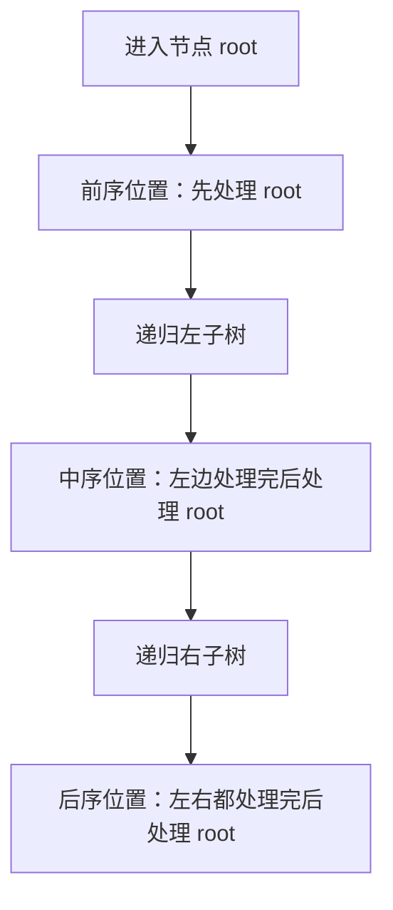

# 树算法

> [!summary] 一句话说明
> 树题本质上是在一棵分层结构里回答三件事：怎么遍历、怎么利用有序性质、怎么把子树答案合并起来。

## 先判断题目在问什么

## 最常用的选择表

| 题目特征 | 优先思路 | 为什么 |
|---|---|---|
| 需要复制树、序列化、先处理当前节点 | [[二叉树遍历/前序遍历|前序遍历]] | 先看根，再决定左右子树 |
| 需要拿到 BST 的有序序列 | [[二叉树遍历/中序遍历|中序遍历]] | 中序天然是“左根右”，BST 下严格递增 |
| 需要统计高度、节点数、平衡性、路径和 | [[二叉树遍历/后序遍历|后序遍历]] | 先拿左右子树答案，再合并当前节点 |
| 需要按层处理、求最小深度、右视图 | [[二叉树遍历/层序遍历|层序遍历]] | BFS 天然分层 |
| 题目强调左 < 根 < 右、有序查找 | [[BST操作/验证BST|BST 操作]] | 利用二叉搜索树单调性 |
| 问最近公共祖先、路径信息 | [[经典问题/最近公共祖先|LCA / 树上递归]] | 子树返回值决定父节点答案 |

## 树和图有什么区别

> [!note] 复习时很容易混淆
> 树可以看成一种特殊的图，但它没有环，而且大多数题都会给你一个明确的根。正因为“没有环 + 有根”，递归才会在树题里这么自然。

## 📚 核心主题

### 1. 二叉树遍历

- [[二叉树遍历/前序遍历|前序遍历]]：根 -> 左 -> 右，适合“先处理当前节点”
- [[二叉树遍历/中序遍历|中序遍历]]：左 -> 根 -> 右，BST 中最关键
- [[二叉树遍历/后序遍历|后序遍历]]：左 -> 右 -> 根，适合“子树先算完”
- [[二叉树遍历/层序遍历|层序遍历]]：按层 BFS，适合最小深度、右视图、层统计

### 2. 二叉树基本操作

- [[二叉树基本操作/树的高度|树的高度]]
- [[二叉树基本操作/树的节点数|树的节点数]]
- [[二叉树基本操作/平衡二叉树|平衡二叉树]]
- [[二叉树基本操作/对称二叉树|对称二叉树]]
- [[二叉树基本操作/翻转二叉树|翻转二叉树]]
- [[二叉树基本操作/合并二叉树|合并二叉树]]

### 3. 二叉搜索树（BST）

- [[BST操作/验证BST|验证 BST]]
- [[BST操作/BST查找|BST 查找]]
- [[BST操作/BST插入|BST 插入]]
- [[BST操作/BST删除|BST 删除]]
- [[BST操作/BST第K小|BST 第 K 小]]

### 4. 经典树题

- [[经典问题/最近公共祖先|最近公共祖先]]
- [[经典问题/最大路径和|最大路径和]]
- [[经典问题/前序中序构造树|前序中序构造树]]
- [[经典问题/树的序列化|树的序列化]]
- [[经典问题/打家劫舍III|树形 DP：打家劫舍 III]]

### 5. 高级树结构

- [[高级树结构/Trie树|Trie 树]]
- [[高级树结构/线段树|线段树]]
- [[高级树结构/树状数组|树状数组]]
- [[高级树结构/并查集|并查集]]

## 🧠 树题最常见的三种递归问法

| 类型 | 递归函数在回答什么 | 典型题 |
|---|---|---|
| 遍历型 | “走到这个节点时我要做什么？” | 前序、层序、路径打印 |
| 分治型 | “这棵子树的答案是什么？” | 高度、节点数、平衡树 |
| 约束型 | “这个节点允许处于什么范围 / 状态？” | 验证 BST、路径和、树形 DP |

## 一张图看前中后序

> [!note] 这个“处理时机”比“顺序名字”更重要
> 很多树题并不是让你真的输出遍历序列，而是让你把逻辑放在前序、中序或后序位置上。

## 建议学习顺序

1. 先掌握 [[二叉树遍历/前序遍历|前序]]、[[二叉树遍历/中序遍历|中序]]、[[二叉树遍历/后序遍历|后序]]、[[二叉树遍历/层序遍历|层序]]。
2. 再做 [[二叉树基本操作/树的高度|树高]]、[[二叉树基本操作/平衡二叉树|平衡树]] 这类后序题。
3. 然后系统做 [[BST操作/验证BST|验证 BST]]、[[BST操作/BST查找|查找]]、[[BST操作/BST删除|删除]]。
4. 最后补 [[经典问题/最近公共祖先|LCA]]、[[经典问题/最大路径和|最大路径和]]、[[经典问题/打家劫舍III|树形 DP]]。

## 易错点

> [!warning] 树题里最常见的错误，是把“遍历顺序”和“递归时机”混为一谈。

- 前序 / 中序 / 后序，决定的是“当前节点什么时候处理”。
- 不是所有树题都要返回整棵树，很多题只需要子树返回一个值。
- 遇到 BST 时，要优先想到它的有序性质，不要按普通树处理。
- 如果题目问路径，先确认答案是“收集路径”还是“汇总子树信息”。

## 相关主题

- [[../图算法/_index|图算法]]：树可以看成特殊图，但写法更偏递归
- [[../动态规划/_index|动态规划]]：树形 DP 属于状态设计的一种特殊形式
- [[../回溯算法/_index|回溯算法]]：前序递归经常和路径搜索结合

---
返回：[[../算法学习导航|算法学习导航]]
