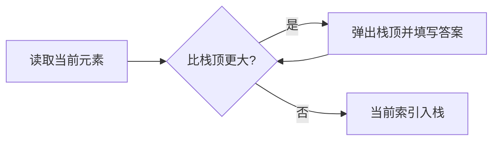

# 单调栈与单调队列

> [!summary] 一句话说明
> 单调结构只保留仍可能成为答案的候选元素；一旦某个候选被新元素彻底支配，就永久删除它。

## 单调栈：找“下一个更大”

处理 `[2, 1, 4, 3]` 时维护尚未找到下一个更大元素的索引：

| 当前值 | 栈（对应值） | 动作 |
|---:|---|---|
| 2 | `[2]` | 入栈 |
| 1 | `[2, 1]` | 入栈 |
| 4 | `[]` | 4 依次解决 1 和 2 |
| 3 | `[4, 3]` | 入栈 |



```go
func nextGreater(nums []int) []int {
    answer := make([]int, len(nums))
    for i := range answer {
        answer[i] = -1
    }

    stack := make([]int, 0, len(nums))
    for i, value := range nums {
        for len(stack) > 0 && value > nums[stack[len(stack)-1]] {
            previous := stack[len(stack)-1]
            stack = stack[:len(stack)-1]
            answer[previous] = value
        }
        stack = append(stack, i)
    }

    return answer
}
```

栈里存索引通常比存值更实用，因为可以计算距离并填写对应位置的答案。

## 单调队列：维护窗口最大值

队列从头到尾保持值递减：

- 队头是当前窗口最大值。
- 新值进入前，队尾所有不大于新值的元素都可以删除。
- 窗口左端移动后，过期索引从队头删除。

```go
func maxSlidingWindow(nums []int, size int) []int {
    queue := make([]int, 0, len(nums))
    answer := make([]int, 0, len(nums))

    for right, value := range nums {
        left := right - size + 1

        for len(queue) > 0 && queue[0] < left {
            queue = queue[1:]
        }
        for len(queue) > 0 && nums[queue[len(queue)-1]] <= value {
            queue = queue[:len(queue)-1]
        }
        queue = append(queue, right)

        if left >= 0 {
            answer = append(answer, nums[queue[0]])
        }
    }

    return answer
}
```

## 为什么被弹出的元素不会再成为答案

假设旧元素 `a` 在新元素 `b` 之前，并且 `a <= b`：

1. `b` 比 `a` 更晚过期。
2. `b` 的值又不小于 `a`。
3. 只要 `a` 还在窗口内，`b` 也一定在，而且更优。

所以 `a` 已经不可能成为后续窗口最大值，可以永久删除。

## 复杂度

每个元素最多入栈/入队一次，并被弹出一次，总时间 `O(n)`，额外空间 `O(n)` 或 `O(k)`。

## 选择指南

| 问题特征 | 使用结构 |
|---|---|
| 下一个更大/更小元素 | 单调栈 |
| 柱状图最大矩形、接雨水 | 单调栈 |
| 固定窗口最大/最小值 | 单调队列 |
| DP 转移只看最近 `k` 个状态最值 | 单调队列 |

> [!warning] 易错点
> - 先确定要维护递增还是递减，再写弹出条件。
> - 相等元素是否弹出取决于题目是否需要保留更早位置。
> - 单调队列必须存索引，否则无法判断元素是否过期。

## 相关主题

- [[../算法模板/数据结构/单调栈模板|单调栈模板]]
- [[../数据结构/栈|栈]]
- [[../数据结构/队列#单调队列详解|队列中的单调队列]]

---
返回：[[_index|算法基础]] | [[../算法学习导航|算法学习导航]]
