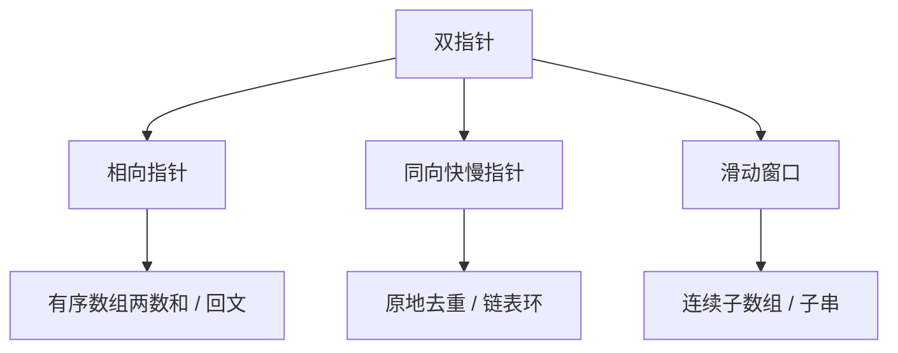
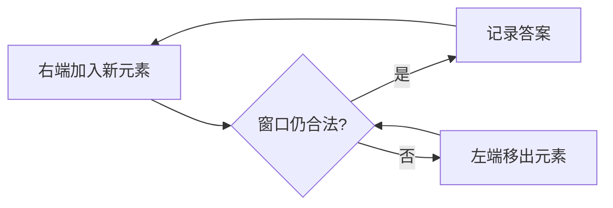

# 双指针

> [!summary] 一句话说明
> 双指针用两个位置描述“已经处理到哪里”，每次移动都排除一批不可能的组合，从而避免重复枚举。

## 三类常见形态



## 相向指针

在升序数组中查找和为 `target` 的两个数：

```text
数组:   1   2   4   7   11   15
        L                   R

和太小 -> L 右移，排除当前 L 与所有更小组合
和太大 -> R 左移，排除当前 R 与所有更大组合
```

```go
func twoSumSorted(nums []int, target int) (int, int, bool) {
    left, right := 0, len(nums)-1

    for left < right {
        total := nums[left] + nums[right]
        if total == target {
            return left, right, true
        }
        if total < target {
            left++
        } else {
            right--
        }
    }

    return -1, -1, false
}
```

> [!note] 不变量
> 如果答案存在，它始终位于闭区间 `[left, right]` 中。移动指针前必须证明被移出的那一端不可能参与答案。

## 同向快慢指针

有序数组原地去重：`fast` 负责探索，`slow` 指向已经保留结果的末尾。

| 时刻 | 已保留区域 | 未检查区域 |
|---|---|---|
| 初始 | `nums[0]` | `nums[1:]` |
| 发现新值 | `slow += 1` 并写入 | `fast` 继续右移 |
| 发现重复 | 不修改 `slow` | 只移动 `fast` |

```go
func deduplicate(nums []int) int {
    if len(nums) == 0 {
        return 0
    }

    slow := 0
    for fast := 1; fast < len(nums); fast++ {
        if nums[fast] != nums[slow] {
            slow++
            nums[slow] = nums[fast]
        }
    }
    return slow + 1
}
```

## 滑动窗口

滑动窗口处理的是**连续区间**。右指针扩张窗口，条件不满足时左指针收缩。



```go
func longestUniqueSubstring(s string) int {
    chars := []rune(s)
    count := make(map[rune]int)
    left, answer := 0, 0

    for right, ch := range chars {
        count[ch]++
        for count[ch] > 1 {
            count[chars[left]]--
            left++
        }
        if width := right - left + 1; width > answer {
            answer = width
        }
    }

    return answer
}
```

## 复杂度为什么通常是 O(n)

每个元素最多被右指针加入一次、被左指针移出一次，总操作次数不超过 `2n`，化简后是 `O(n)`。

## 易错点

- 题目不是连续区间时，不要机械套滑动窗口。
- 窗口长度是 `right - left + 1`，右开区间才是 `right - left`。
- 收缩条件要与“窗口是否合法”的定义完全一致。
- 链表快慢指针要先检查 `fast` 和 `fast.next`。

## 相关主题

- [[../算法模板/基础算法/双指针模板|双指针模板]]
- [[../算法模板/基础算法/滑动窗口模板|滑动窗口模板]]
- [[../字符串算法/滑动窗口|字符串滑动窗口]]

---
返回：[[_index|算法基础]] | [[../算法学习导航|算法学习导航]]
