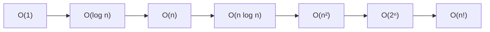
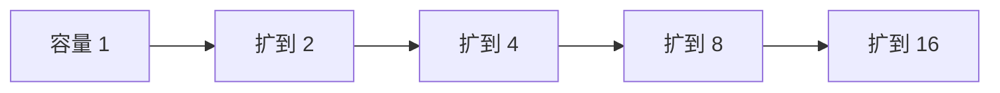

# 复杂度分析

> [!summary] 一句话说明
> 复杂度不是精确运行时间，而是输入规模 `n` 增大时，计算量和内存增长得有多快。

## 为什么先看数据规模

假设评测环境每秒大约能执行 `10^7` 到 `10^8` 次简单操作，可以先做粗略判断：

| 数据规模 `n` | 常见可接受复杂度 |
|---:|---|
| `n <= 20` | `O(2^n)`、状态压缩 |
| `n <= 200` | `O(n^3)` |
| `n <= 2,000` | `O(n^2)` |
| `n <= 100,000` | `O(n log n)` |
| `n <= 10,000,000` | `O(n)` |

这只是量级估算；语言、常数、缓存命中和输入分布都会影响实际时间。

## 增长速度图



当 `n` 翻倍时：

| 复杂度 | 计算量大致变化 |
|---|---:|
| `O(log n)` | 只增加一个常数量级 |
| `O(n)` | 约 2 倍 |
| `O(n log n)` | 略高于 2 倍 |
| `O(n^2)` | 约 4 倍 |
| `O(2^n)` | 乘上 `2^n` 对应的巨大倍数 |

## 如何从代码推导

### 顺序执行：取最大项

```go
for _, x := range nums { // O(n)
    total += x
}

slices.Sort(nums) // O(n log n)
```

总复杂度为 `O(n + n log n) = O(n log n)`。

### 嵌套循环：相乘

```go
for i := 0; i < n; i++ {
    for j := 0; j < n; j++ {
        work(i, j)
    }
}
```

外层执行 `n` 次，内层每次执行 `n` 次，总计 `n * n`，即 `O(n^2)`。

### 指数缩小：对数

```go
for n > 1 {
    n /= 2
}
```

执行 `k` 次后有 `n / 2^k <= 1`，所以 `k = O(log n)`。

### 双指针不是两层循环

```go
right := 0
for left := 0; left < n; left++ {
    for right < n && canExpand(left, right) {
        right++
    }
}
```

虽然形式上嵌套，但 `right` 从不回退，整个过程最多移动 `n` 次，因此总复杂度是 `O(n)`。

## 最好、平均与最坏情况

以快速排序为例：

| 情况 | 分区形态 | 时间复杂度 |
|---|---|---|
| 最好 | 每次接近平分 | `O(n log n)` |
| 平均 | 随机输入下大致平衡 | `O(n log n)` |
| 最坏 | 每次只减少一个元素 | `O(n^2)` |

工程中通常关注最坏情况是否可接受，同时结合平均情况判断实际性能。

## 均摊复杂度

动态数组 `append` 偶尔需要扩容并复制全部元素，看起来一次操作是 `O(n)`；但容量通常按倍数增长，前 `n` 次追加中的总复制次数仍是 `O(n)`，所以单次追加的**均摊复杂度**为 `O(1)`。



总复制量约为 `1 + 2 + 4 + ... + n/2 < n`。

## 递归复杂度

常见递推式：

| 递推式 | 典型算法 | 结果 |
|---|---|---|
| `T(n) = T(n/2) + O(1)` | 二分查找 | `O(log n)` |
| `T(n) = 2T(n/2) + O(n)` | 归并排序 | `O(n log n)` |
| `T(n) = T(n-1) + O(n)` | 退化快排 | `O(n^2)` |

画递归树时分别看“每层总工作量”和“树高”，通常比死记公式更可靠。

## 空间复杂度

空间复杂度统计算法额外占用的空间：

- 原地交换数组元素通常是 `O(1)` 额外空间。
- 长度为 `n` 的辅助数组是 `O(n)`。
- 平衡递归树的调用栈通常是 `O(log n)`。
- 链式递归深度达到 `n` 时，调用栈是 `O(n)`。

> [!warning] 常见误区
> - `O(2n)` 要化简为 `O(n)`，常数不改变增长阶。
> - 两段独立循环是相加，不是相乘。
> - 嵌套循环不一定是 `O(n^2)`，要看指针是否重复扫描。
> - 哈希表的 `O(1)` 通常是平均复杂度，极端冲突下可能退化。
> - 递归代码还要计算调用栈空间。

## 相关主题

- [[递归与迭代]]
- [[../排序算法/_index|排序算法]]
- [[../分治算法/_index|分治算法]]

---
返回：[[_index|算法基础]] | [[../算法学习导航|算法学习导航]]
