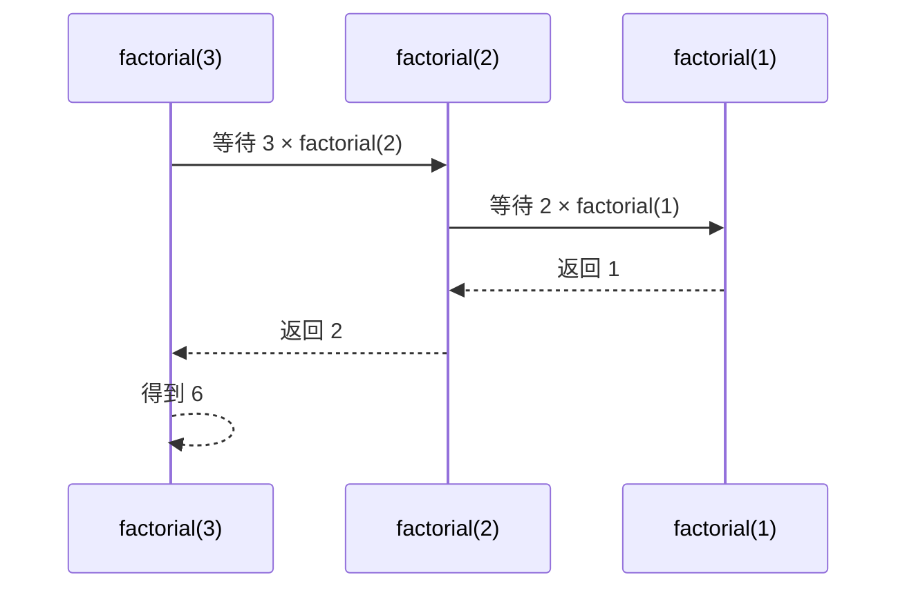
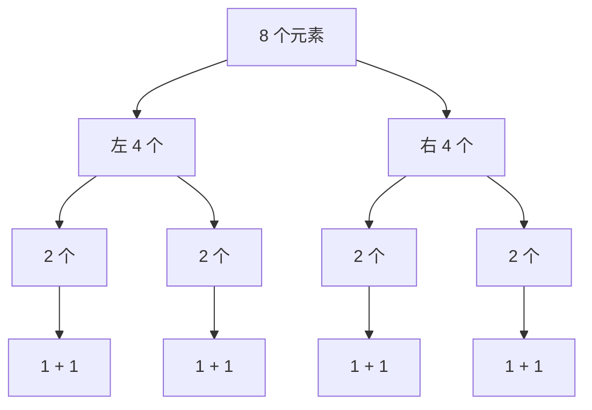

# 递归与迭代

> [!summary] 一句话说明
> 递归把大问题交给“规模更小的自己”；迭代把尚未完成的状态显式保存在变量、栈或队列中。

## 一个递归必须回答三个问题

1. **函数含义**：输入是什么，返回值代表什么。
2. **规模如何缩小**：每次调用必须更接近终止条件。
3. **终止条件**：最小问题可以直接回答什么。

以阶乘为例：

```go
func factorial(n int) int {
    if n <= 1 {
        return 1
    }
    return n * factorial(n-1)
}
```

## 调用栈图解



递归不是“凭空跳转”。每次调用都会在调用栈中保存参数、局部变量和返回位置。

## 递归树怎么看

以归并排序为例，每个问题拆成两个一半大小的子问题：



树高为 `O(log n)`，每层合并的总工作量是 `O(n)`，所以总时间是 `O(n log n)`。

## 改写为迭代

尾部递归通常可以直接改成循环：

```go
func factorialIterative(n int) int {
    result := 1
    for n > 1 {
        result *= n
        n--
    }
    return result
}
```

树和图的递归 DFS 则需要显式栈：

```go
func dfsIterative(graph map[int][]int, start int) []int {
    order := make([]int, 0)
    visited := make(map[int]bool)
    stack := []int{start}

    for len(stack) > 0 {
        node := stack[len(stack)-1]
        stack = stack[:len(stack)-1]
        if visited[node] {
            continue
        }
        visited[node] = true
        order = append(order, node)

        neighbors := graph[node]
        for i := len(neighbors) - 1; i >= 0; i-- {
            stack = append(stack, neighbors[i])
        }
    }

    return order
}
```

`reversed` 不是算法必需，只是让迭代版访问顺序与常见递归版一致。

## 什么时候选哪一种

| 场景 | 递归 | 迭代 |
|---|---|---|
| 树、分治、回溯 | 结构自然，代码短 | 可避免深度过大 |
| 简单线性重复 | 容易产生多余栈帧 | 通常更直接 |
| 需要精确控制状态 | 隐式调用栈不易观察 | 显式栈/队列更灵活 |
| 深度可能达到 `10^5` | 有栈溢出风险 | 更安全 |

> [!warning] 常见错误
> - 没有终止条件，或问题规模没有严格缩小。
> - 在多个递归分支间错误共享可变状态。
> - 回溯时忘记撤销选择。
> - 只计算递归函数体的复杂度，忽略调用次数。

## 相关主题

- [[../分治算法/_index|分治算法]]
- [[../回溯算法/_index|回溯算法]]
- [[../树算法/_index|树算法]]
- [[../图算法/图的遍历/DFS与BFS|DFS 与 BFS]]

---
返回：[[_index|算法基础]] | [[../算法学习导航|算法学习导航]]
