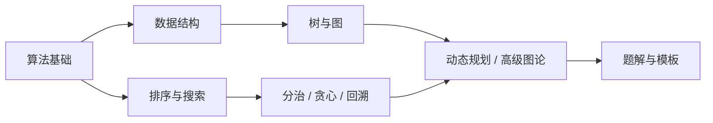

# 算法学习导航

> [!abstract] 说明
> 本目录用于存放各类算法学习资料、笔记和题解，是系统化学习算法和数据结构的完整知识库。

> [!tip] 笔记要求
> 算法类笔记优先按 [[算法笔记写作规范]] 补齐：浅显原理、实现方式、为什么这样实现、图解或状态变化示例。代码模板要说明变量含义和边界原因，避免只保存代码。

> [!info] 完整性记录
> 目录覆盖情况、已补缺口和后续高级扩展统一记录在 [[算法知识体系审计]]。

## 📚 目录结构

### 🧭 算法基础

- [[算法基础/_index|算法基础]] - 分析复杂度、理解递归和掌握常用线性技巧
  - [[算法基础/复杂度分析|复杂度分析]] - 从数据规模判断算法是否可行
  - [[算法基础/递归与迭代|递归与迭代]] - 调用栈、递归树和显式状态
  - [[算法基础/双指针|双指针]] - 相向、快慢和滑动窗口
  - [[算法基础/前缀和与差分|前缀和与差分]] - 区间查询与批量修改
  - [[算法基础/单调栈与单调队列|单调栈与单调队列]] - 维护最优候选

### 🎯 实战练习

#### LeetCode题解
- [[LeetCode题解/_index|LeetCode题解]] - 系统化的LeetCode刷题指南
  - [[LeetCode题解/按难度分类/简单题清单|简单题清单]] - 50道必做简单题
  - [[LeetCode题解/按难度分类/中等题清单|中等题清单]] - 80道高频中等题
  - [[LeetCode题解/按难度分类/困难题清单|困难题清单]] - 50道精选困难题
  - [[LeetCode题解/按数据结构分类/数据结构题解索引|数据结构题解索引]] - 按数据结构分类的题解
  - [[LeetCode题解/按算法分类/算法题解索引|算法题解索引]] - 按算法分类的题解
  - [[LeetCode题解/经典题单/LeetCode Hot 100|LeetCode Hot 100]] - 官方精选100题
  - [[LeetCode题解/经典题单/LeetCode 75|LeetCode 75]] - 官方75题路线
  - [[LeetCode题解/经典题单/Top Interview 150|Top Interview 150]] - 官方150题路线
  - [[LeetCode题解/经典题单/剑指Offer|剑指Offer]] - 国内面试必备75题
  - [[LeetCode题解/题解模板/题解模板说明|题解模板说明]] - 规范的题解撰写格式

### 🏗️ 基础数据结构
- [[数据结构/_index|数据结构]] - 数组、链表、栈、队列、哈希表、堆等基础数据结构
  - [[数据结构/数组|数组]] - 随机访问、双指针、前缀和的载体
  - [[数据结构/链表|链表]] - 指针操作、反转、快慢指针
  - [[数据结构/栈|栈]] - 单调栈、表达式与括号问题
  - [[数据结构/队列|队列]] - BFS、层序遍历、单调队列
  - [[数据结构/哈希表|哈希表]] - 计数、去重、映射
  - [[数据结构/堆|堆]] - Top K、优先队列、中位数
  - [[数据结构/并查集|并查集]] - 连通性、Kruskal、集合合并
  - [[数据结构/Trie树|Trie树]] - 前缀匹配与字典树
  - [[数据结构/线段树|线段树]] - 区间查询与区间更新
  - [[数据结构/树状数组|树状数组]] - 动态前缀和、逆序对
  - [[数据结构/跳表|跳表]] - 多层索引有序结构
  - [[数据结构/布隆过滤器|布隆过滤器]] - 概率型存在性判断
  - [[数据结构/稀疏表|稀疏表]] - 静态区间最值 O(1) 查询

### 🔍 排序与搜索

#### 排序算法
- [[排序算法/_index|排序算法]] - 各类排序算法详解
  - [[排序算法/冒泡排序|冒泡排序]] - O(n²) 基础排序
  - [[排序算法/选择排序|选择排序]] - O(n²) 基础排序
  - [[排序算法/插入排序|插入排序]] - O(n²) 基础排序
  - [[排序算法/快速排序|快速排序]] - O(nlogn) 分治排序
  - [[排序算法/归并排序|归并排序]] - O(nlogn) 稳定排序
  - [[排序算法/堆排序|堆排序]] - O(nlogn) 原地排序
  - [[排序算法/计数排序|计数排序]] - O(n+k) 非比较排序
  - [[排序算法/桶排序|桶排序]] - O(n+k) 分桶排序
  - [[排序算法/基数排序|基数排序]] - O(d·n) 多关键字排序

#### 搜索算法
- [[搜索算法/_index|搜索算法]] - 各类搜索算法详解
  - [[搜索算法/二分查找/标准二分查找|标准二分查找]] - O(logn) 有序查找
  - [[搜索算法/二分查找/左边界查找|左边界查找]] - 左边界二分查找
  - [[搜索算法/二分查找/右边界查找|右边界查找]] - 右边界二分查找
  - [[搜索算法/深度优先搜索/DFS基础模板|深度优先搜索DFS]] - 图的深度遍历
  - [[搜索算法/广度优先搜索/BFS基础模板|广度优先搜索BFS]] - 图的广度遍历
  - [[搜索算法/高级搜索/A星搜索|A*搜索]] - 启发式最短路径

### 💡 高级算法技巧

#### 动态规划
- [[动态规划/_index|动态规划]] - DP问题与状态转移
  - [[动态规划/一维DP|一维DP]] - 爬楼梯、打家劫舍、最大子数组和
  - [[动态规划/二维DP|二维DP]] - 不同路径、编辑距离、最长公共子序列
  - [[动态规划/背包问题|背包问题]] - 0-1背包、完全背包、多重背包
  - [[动态规划/区间DP|区间DP]] - 戳气球、矩阵链乘法
  - [[动态规划/状态压缩DP|状态压缩DP]] - 旅行商问题、集合DP
  - [[动态规划/树形DP|树形DP]] - 树上的动态规划

#### 贪心算法
- [[贪心算法/_index|贪心算法]] - 贪心策略与证明
  - [[贪心算法/区间问题/区间调度|区间调度]] - 活动选择问题
  - [[贪心算法/区间问题/区间覆盖|区间覆盖]] - 最少区间覆盖
  - [[贪心算法/排序贪心/跳跃游戏|跳跃游戏]] - 贪心+BFS思想
  - [[贪心算法/排序贪心/分配问题|分配问题]] - 分配饼干、分发糖果
  - [[贪心算法/数字贪心/股票买卖|股票买卖]] - 股票交易问题

#### 回溯算法
- [[回溯算法/_index|回溯算法]] - 全排列、组合、子集等
  - [[回溯算法/子集问题|子集问题]] - 所有子集的生成
  - [[回溯算法/组合问题|组合问题]] - 组合数生成
  - [[回溯算法/全排列|全排列]] - 所有排列的生成
  - [[回溯算法/N皇后|N皇后]] - 经典回溯问题
  - [[回溯算法/解数独|解数独]] - 复杂约束回溯
  - [[回溯算法/括号生成|括号生成]] - 生成有效括号组合
  - [[回溯算法/电话号码的字母组合|电话号码的字母组合]] - 字母组合问题

#### 分治算法
- [[分治算法/_index|分治算法]] - 分而治之的思想
  - [[分治算法/数组逆序对|数组逆序对]] - 归并排序求逆序对
  - [[分治算法/寻找中位数|寻找中位数]] - 快速选择第K大元素
  - [[分治算法/快速幂|快速幂]] - 快速幂运算
  - [[分治算法/最大子数组和|最大子数组和]] - 分治求最大子数组和

### 🌲 专题算法

#### 图算法
- [[图算法/_index|图算法]] - 最短路径、最小生成树、拓扑排序等
  - [[图算法/图的基础/图的表示|图的表示]] - 邻接矩阵、邻接表、边集数组
  - [[图算法/图的遍历/DFS与BFS|DFS与BFS]] - 深度优先搜索与广度优先搜索
  - [[图算法/最短路径/单源最短路径|单源最短路径]] - Dijkstra、Bellman-Ford
  - [[图算法/最短路径/多源最短路径|多源最短路径]] - Floyd-Warshall
  - [[图算法/最小生成树与拓扑排序/最小生成树|最小生成树]] - Kruskal、Prim
  - [[图算法/最小生成树与拓扑排序/拓扑排序|拓扑排序]] - Kahn算法、DFS实现
  - [[图算法/连通性问题/强连通分量|强连通分量]] - Tarjan算法
  - [[图算法/二分图/二分图判定与匹配|二分图判定与匹配]] - 染色法
  - [[图算法/高级专题/0-1 BFS|0-1 BFS]] - 0/1 权图的线性最短路
  - [[图算法/高级专题/欧拉路径与回路|欧拉路径与回路]] - 每条边恰好使用一次
  - [[图算法/高级专题/网络流与最大流|网络流与最大流]] - Dinic 与最大流最小割

#### 树算法
- [[树算法/_index|树算法]] - 二叉树、BST、Trie、线段树等
  - [[树算法/二叉树遍历/前序遍历|前序遍历]] - 递归与迭代实现
  - [[树算法/二叉树遍历/中序遍历|中序遍历]] - 递归与迭代实现
  - [[树算法/二叉树遍历/后序遍历|后序遍历]] - 递归与迭代实现
  - [[树算法/二叉树遍历/层序遍历|层序遍历]] - BFS层序遍历
  - [[树算法/BST操作/验证BST|验证BST]] - 验证二叉搜索树
  - [[树算法/BST操作/BST第K小|BST第K小]] - 第K小元素
  - [[树算法/高级树结构/Trie树|Trie树]] - 前缀树实现
  - [[树算法/高级树结构/线段树|线段树]] - 线段树操作
  - [[树算法/高级树结构/树状数组|树状数组]] - 树状数组实现

#### 字符串算法
- [[字符串算法/_index|字符串算法]] - KMP、Manacher、字符串匹配等
  - [[字符串算法/KMP算法|KMP算法]] - 字符串模式匹配
  - [[字符串算法/Manacher算法|Manacher算法]] - 最长回文子串
  - [[字符串算法/滑动窗口|滑动窗口]] - 字符串滑动窗口技巧
  - [[字符串算法/编辑距离|编辑距离]] - 字符串编辑距离DP
  - [[字符串算法/最长公共子序列|最长公共子序列]] - LCS问题
  - [[字符串算法/Rabin-Karp算法|Rabin-Karp算法]] - 滚动哈希匹配
  - [[字符串算法/Z算法|Z算法]] - 前缀与后缀线性匹配
  - [[字符串算法/AC自动机|AC自动机]] - 多模式串匹配

#### 数学算法
- [[数学算法/_index|数学算法]] - 质数、GCD、快速幂等
  - [[数学算法/数论基础/质数判断与筛法|质数判断与筛法]] - 埃氏筛、线性筛
  - [[数学算法/数论基础/GCD与LCM|GCD与LCM]] - 欧几里得算法
  - [[数学算法/数论基础/扩展欧几里得与模逆元|扩展欧几里得与模逆元]] - 求逆元和线性同余
  - [[数学算法/数论基础/同余与模运算|同余与模运算]] - 模世界里的加减乘除
  - [[数学算法/快速幂与矩阵/快速幂算法|快速幂算法]] - 快速幂、矩阵快速幂
  - [[数学算法/组合数学/排列组合|排列组合]] - 组合数计算
  - [[数学算法/组合数学/组合数取模与Lucas定理|组合数取模与Lucas定理]] - 组合数在质数模下的求法
  - [[数学算法/组合数学/卡特兰数|卡特兰数]] - 合法括号与 BST 结构数
  - [[数学算法/经典数列/斐波那契数列|斐波那契数列]] - 斐波那契数列实现

#### 位运算
- [[位运算/_index|位运算]] - 位操作技巧
  - [[位运算/只出现一次的数字|只出现一次的数字]] - 异或运算
  - [[位运算/比特位计数|比特位计数]] - 统计二进制中1的个数
  - [[位运算/2的幂|2的幂]] - 判断2的幂
  - [[位运算/子集|子集]] - 位运算生成子集
  - [[位运算/旅行商问题TSP|旅行商问题TSP]] - 状态压缩DP

### 🛠️ 算法模板
- [[算法模板/_index|算法模板]] - 常用算法模板代码
  - [[算法模板/数据结构/并查集模板|并查集模板]] - Union-Find模板
  - [[算法模板/数据结构/单调栈模板|单调栈模板]] - 单调栈应用模板
  - [[算法模板/基础算法/二分查找模板|二分查找模板]] - 二分查找各种变体
  - [[算法模板/基础算法/双指针模板|双指针模板]] - 双指针技巧模板
  - [[算法模板/基础算法/滑动窗口模板|滑动窗口模板]] - 滑动窗口模板
  - [[算法模板/动态规划/背包问题模板|背包问题模板]] - 各类背包DP模板
  - [[算法模板/图算法/最短路径模板|最短路径模板]] - Dijkstra、Floyd模板

## 📖 学习路线

### 🌱 入门阶段（1-2个月）

#### Week 1-2: 基础数据结构
**学习目标**：掌握基本数据结构的操作
- [ ] **数组与链表**
  - 数组的基本操作（插入、删除、查找）
  - 链表的基本操作（反转、合并、删除节点）
  - LeetCode: 1, 21, 26, 27, 88, 206

- [ ] **栈与队列**
  - 栈的应用（括号匹配、单调栈）
  - 队列的应用（BFS、滑动窗口）
  - LeetCode: 20, 155, 232, 739

- [ ] **哈希表**
  - 哈希表的查找、插入、删除
  - 两数之和、字母异位词分组
  - LeetCode: 1, 49, 242, 349, 350

#### Week 3-4: 基础算法
**学习目标**：掌握基础算法思想
- [ ] **排序算法**
  - 冒泡排序、选择排序、插入排序（O(n²)）
  - 快速排序、归并排序、堆排序（O(nlogn)）
  - LeetCode: 912（排序数组）

- [ ] **二分查找**
  - 标准二分查找
  - 左右边界查找
  - LeetCode: 35, 69, 704, 34

- [ ] **双指针技巧**
  - 快慢指针、对撞指针
  - 三数之和、盛最多水的容器
  - LeetCode: 11, 15, 283, 344

**里程碑检查**：
- ✅ 完成50道简单题
- ✅ 通过率 > 80%
- ✅ 理解基本数据结构和算法

### 🌿 进阶阶段（2-4个月）

#### Week 5-8: 树相关算法
**学习目标**：掌握树的各种操作
- [ ] **二叉树遍历**
  - 前序、中序、后序遍历（递归+迭代）
  - 层序遍历（BFS）
  - LeetCode: 94, 102, 144, 145

- [ ] **二叉搜索树（BST）**
  - BST的性质和操作
  - 验证BST、第K小元素
  - LeetCode: 98, 230, 235, 450

- [ ] **树的递归**
  - 树的深度、直径
  - 翻转二叉树、对称二叉树
  - LeetCode: 101, 104, 110, 226, 543

#### Week 9-12: 图相关算法
**学习目标**：掌握图的基本算法
- [ ] **图的表示**
  - 邻接矩阵、邻接表
  - 边集数组

- [ ] **DFS与BFS**
  - 图的深度优先搜索
  - 图的广度优先搜索
  - LeetCode: 200, 133, 207, 797

- [ ] **最短路径**
  - Dijkstra算法（非负权）
  - Bellman-Ford算法（含负权）
  - Floyd-Warshall算法（所有点对）
  - LeetCode: 743, 787, 1334

#### Week 13-16: 动态规划入门
**学习目标**：理解DP的基本思想
- [ ] **一维DP**
  - 爬楼梯、打家劫舍
  - 最大子数组和、最长递增子序列
  - LeetCode: 70, 198, 53, 300

- [ ] **二维DP**
  - 不同路径、最小路径和
  - 编辑距离、最长公共子序列
  - LeetCode: 62, 64, 72, 1143

- [ ] **背包问题**
  - 0-1背包、完全背包
  - 分割等和子集、零钱兑换
  - LeetCode: 322, 416, 494, 518

**里程碑检查**：
- ✅ 完成150道中等题
- ✅ 掌握树和图的基本算法
- ✅ 理解动态规划思想

### 🌳 高级阶段（3-6个月）

#### Week 17-20: 高级数据结构
**学习目标**：掌握高级数据结构
- [ ] **堆与优先队列**
  - 最大堆、最小堆
  - 第K大元素、中位数
  - LeetCode: 215, 295, 347, 703

- [ ] **并查集**
  - 路径压缩、按秩合并
  - 连通性问题
  - LeetCode: 547, 684, 990, 1319

- [ ] **Trie树**
  - 前缀树的构建和应用
  - 单词搜索、前缀匹配
  - LeetCode: 208, 211, 648

- [ ] **线段树与树状数组**
  - 区间查询和修改
  - 应用场景

#### Week 21-24: 高级算法
**学习目标**：掌握高级算法技巧
- [ ] **高级动态规划**
  - 状态压缩DP
  - 区间DP（戳气球）
  - 树形DP
  - LeetCode: 312, 1000, 337

- [ ] **贪心算法**
  - 贪心策略的证明
  - 区间调度、跳跃游戏
  - LeetCode: 45, 55, 122, 135, 452

- [ ] **回溯与剪枝**
  - 子集、组合、排列
  - N皇后、解数独
  - LeetCode: 37, 39, 40, 46, 47, 51, 78

- [ ] **分治算法**
  - 归并排序的应用
  - 快速选择
  - LeetCode: 215, 493

#### Week 25-28: 专题深化
**学习目标**：深入掌握专题算法
- [ ] **图的高级算法**
  - 拓扑排序（Kahn、DFS）
  - 强连通分量（Tarjan）
  - 最小生成树（Kruskal、Prim）
  - LeetCode: 207, 210, 1192, 1584

- [ ] **字符串匹配**
  - KMP算法
  - Rabin-Karp算法
  - 最长回文子串（Manacher）
  - LeetCode: 28, 5, 647

- [ ] **位运算技巧**
  - 基本位运算
  - 位运算应用
  - LeetCode: 136, 191, 231, 338, 461

**里程碑检查**：
- ✅ 完成50道困难题
- ✅ 掌握所有核心算法
- ✅ 总题量 300+

## 📝 学习资源

### 📚 在线平台
- [LeetCode中文](https://leetcode.cn/) - 算法题库，必刷平台
- [LeetCode英文](https://leetcode.com/) - 英文版，题解更丰富
- [洛谷](https://www.luogu.com.cn/) - 算法竞赛练习
- [牛客网](https://www.nowcoder.com/) - 面试算法题
- [Codeforces](https://codeforces.com/) - 国际竞赛平台
- [AtCoder](https://atcoder.jp/) - 日本竞赛平台

### 📖 推荐书籍

#### 入门级
- 《剑指Offer》 - 国内面试必备，66道经典题
- 《程序员代码面试指南》 - IT名企算法与数据结构题目最优解
- 《算法图解》 - 图文并茂，适合入门

#### 进阶级
- 《算法》第四版（Algorithms 4th Edition） - Sedgewick经典教材
- 《算法竞赛进阶指南》 - 竞赛必备
- 《挑战程序设计竞赛》 - 日本经典竞赛书籍

#### 理论级
- 《算法导论》（Introduction to Algorithms） - CLRS圣经
- 《算法设计手册》（The Algorithm Design Manual） - Skiena
- 《算法心得》 - 高级算法技巧

### 🎬 视频课程

#### 中文课程
- [代码随想录](https://programmercarl.com/) - 系统的算法学习路线
- [labuladong的算法小抄](https://labuladong.online/algo/) - 框架思维
- [花花酱LeetCode](https://space.bilibili.com/9880352) - 详细题解
- [左程云算法课程](https://space.bilibili.com/8888480) - 进阶课程

#### 英文课程
- [MIT 6.006 Introduction to Algorithms](https://ocw.mit.edu/courses/6-006-introduction-to-algorithms-fall-2011/) - MIT公开课
- [Coursera - Algorithms Specialization](https://www.coursera.org/specializations/algorithms) - Stanford
- [Princeton Algorithms](https://www.coursera.org/learn/algorithms-part1) - Princeton

### 🌐 在线资源
- [VisuAlgo](https://visualgo.net/zh) - 算法可视化
- [Algorithm Visualizer](https://algorithm-visualizer.org/) - 算法动画演示
- [Big-O Cheat Sheet](https://www.bigocheatsheet.com/) - 复杂度速查
- [CP-Algorithms](https://cp-algorithms.com/) - 算法百科

## 🎯 刷题计划

### 📅 每日目标
- [ ] **工作日**
  - 早上：1道简单/中等题（30-45分钟）
  - 晚上：复习1道已做题目（15-20分钟）

- [ ] **周末**
  - 上午：2-3道中等题（2-3小时）
  - 下午：1道困难题/专题复习（1-2小时）

### 📊 周目标
- [ ] 新题：10-15题
- [ ] 复习：5-8题
- [ ] 总结：整理1个算法专题
- [ ] 模板：完善1-2个算法模板

### 🗓️ 月目标
- [ ] 新题：40-60题
- [ ] 复习：20-30题
- [ ] 掌握：2-3个算法专题
- [ ] 参加：1-2次周赛（检验水平）

## 📊 进度追踪

### LeetCode进度
| 难度 | 已完成 | 目标 | 进度 |
|------|--------|------|------|
| 🟢 简单 | 0 | 200 | 0% |
| 🟠 中等 | 0 | 300 | 0% |
| 🔴 困难 | 0 | 100 | 0% |
| **总计** | **0** | **600** | **0%** |

### 专题维护状态
| 专题 | 当前状态 | 下一步 |
|------|----------|--------|
| 数据结构 | 主干笔记已整理 | 沉淀真实题解 |
| 排序搜索 | 主干笔记已整理，已有动画 | 补边界题和综合题 |
| 动态规划 | 主干笔记已整理 | 补状态压缩与区间题解 |
| 图算法 | 主干笔记已整理，已有动画 | 补高级专题题解 |
| 贪心算法 | 主干笔记已整理 | 补策略证明 |
| 回溯算法 | 主干笔记已整理 | 补剪枝对比动画 |
| 树算法 | 主干笔记已整理，已有动画 | 沉淀 BST 与 LCA 题解 |
| 字符串 | 主干笔记已整理 | 补匹配算法对比 |

### 题单进度
| 题单 | 已完成 | 总题数 | 进度 |
|------|--------|--------|------|
| LeetCode Hot 100 | 0 | 100 | 0% |
| 剑指Offer | 0 | 75 | 0% |
| 简单题清单 | 0 | 50 | 0% |
| 中等题清单 | 0 | 80 | 0% |
| 困难题清单 | 0 | 50 | 0% |

## 🏆 阶段里程碑

### 入门阶段（1-2个月）
- [ ] 完成50道简单题
- [ ] 掌握基本数据结构（数组、链表、栈、队列、哈希表）
- [ ] 理解基础算法（排序、二分、双指针）
- [ ] 通过率 > 80%

### 进阶阶段（3-5个月）
- [ ] 完成150道中等题
- [ ] 掌握核心算法（DP、回溯、贪心、图论）
- [ ] 刷完LeetCode Hot 100
- [ ] 理解算法时间复杂度分析

### 冲刺阶段（6个月+）
- [ ] 完成50道困难题
- [ ] 刷完剑指Offer
- [ ] 总题量 300+
- [ ] 参加周赛，rating > 1800

### 专家阶段（1年+）
- [ ] 总题量 500+
- [ ] 所有专题深入掌握
- [ ] 能独立分析和优化算法
- [ ] 竞赛 rating > 2000

## 💡 学习建议

> [!tip] 核心原则
> 1. **循序渐进**：从简单到困难，打好基础
> 2. **理解优先**：理解思路比记忆代码更重要
> 3. **一题多解**：尝试不同解法，培养优化思维
> 4. **定期复习**：使用遗忘曲线，巩固已学内容
> 5. **总结模板**：整理常用模板，形成代码库

> [!warning] 常见误区
> - ❌ 只做题不总结
> - ❌ 死记硬背代码
> - ❌ 追求题量忽视质量
> - ❌ 不复习已做题目
> - ❌ 遇到困难就看答案

> [!success] 高效方法
> - ✅ 做题前先思考5-10分钟
> - ✅ 一题至少做2遍（间隔1-3天）
> - ✅ 总结题型和解题模板
> - ✅ 参加周赛检验水平
> - ✅ 定期回顾错题

## 🛠️ 工具推荐

### 刷题平台
- **LeetCode CN** - 主要平台，中文界面
- **力扣竞赛** - 周赛、双周赛，检验水平
- **牛客网** - 模拟面试，公司真题

### 学习工具
- **Obsidian** - 记录题解（当前知识库）
- **Anki** - 间隔复习，防止遗忘
- **GitHub** - 代码管理，建立个人题库
- **Notion** - 进度追踪，学习计划

### 开发工具
- **VS Code** - 轻量级编辑器
- **GoLand** - Go 专用 IDE
- **Go Playground** - 在线运行 Go 示例
- **Vim/Emacs** - 竞赛环境

---

**最后更新**：2026-08-09
**文档版本**：v2.0
**维护者**：个人学习笔记

> [!quote] 名言
> “算法是计算机科学的核心，掌握算法就是掌握了解决问题的钥匙。” - Donald Knuth
