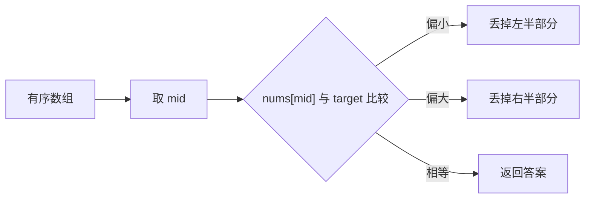

# 二分查找模板

## 一句话说明

二分查找的核心是**缩小搜索范围**，关键在于边界条件的处理。

浅显地说，二分查找不是“猜中间”，而是每次用中间值判断哪一半已经不可能有答案，然后把那一半整体丢掉。



## 🧠 为什么边界这么写

二分最重要的是保持“不变量”：答案如果存在，一定还在当前搜索区间里。

| 区间写法 | 初始值 | 循环条件 | 舍弃方式 |
|----------|--------|----------|----------|
| 左闭右闭 `[left, right]` | `right = len(nums) - 1` | `left <= right` | `left = mid + 1` 或 `right = mid - 1` |
| 左闭右开 `[left, right)` | `right = len(nums)` | `left < right` | `left = mid + 1` 或 `right = mid` |

`right = mid` 不是少减了 1，而是因为右边界本来就是开区间，`mid` 这个位置还可能是答案，不能直接丢掉。

## 💻 模板代码

## 适用场景

| 模板 | 使用场景 | 返回值 |
|------|---------|--------|
| 标准二分 | 查找target | target的索引，不存在返回-1 |
| 左边界 | 第一个>=target | 插入位置或第一个等于target的位置 |
| 右边界 | 最后一个<=target | 最后一个等于target的位置 |
| 二分答案 | 最值问题 | 满足条件的最值 |

## 易错点

1. **区间定义要统一**：左闭右闭 `[left, right]` 或左闭右开 `[left, right)`
2. **循环条件**：左闭右闭用 `left <= right`，左闭右开用 `left < right`
3. **防止溢出**：用 `left + (right - left) // 2` 而不是 `(left + right) // 2`
4. **边界更新**：左闭右闭更新为 `mid ± 1`，左闭右开根据情况

## Go 代码

```go
// 标准二分查找
func binarySearch(nums []int, target int) int {
    left, right := 0, len(nums)-1

    for left <= right {
        mid := left + (right-left)/2

        if nums[mid] == target {
            return mid
        } else if nums[mid] < target {
            left = mid + 1
        } else {
            right = mid - 1
        }
    }

    return -1
}

// 查找左边界
func searchLeftBound(nums []int, target int) int {
    left, right := 0, len(nums)

    for left < right {
        mid := left + (right-left)/2

        if nums[mid] < target {
            left = mid + 1
        } else {
            right = mid
        }
    }

    return left
}
```

---
返回：[[../_index|算法模板]]
