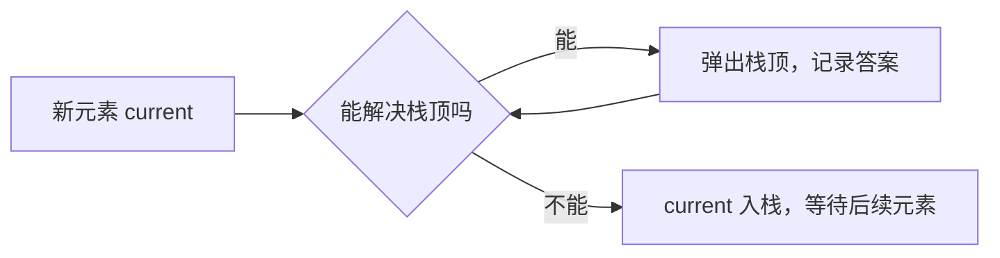

# 单调栈模板

## 一句话说明

单调栈用于解决**下一个更大/更小元素**问题，维护一个单调递增或递减的栈。

浅显地说，单调栈是在维护一队“还没等到答案的人”。当新元素出现时，它会把所有已经能确定答案的人一次性处理掉。



## 🧠 为什么被弹出的元素不用再看

以下一个更大元素为例，栈保持单调递减。当前元素 `current` 如果比栈顶大，那么它就是栈顶右边第一个更大的元素；栈顶答案已经确定，可以弹出。被弹出的元素以后不会再参与比较，因为它要找的是“第一个”更大元素，当前元素已经满足且距离最近。

| 动作 | 含义 |
|------|------|
| 入栈 | 当前元素还没有找到答案 |
| 弹栈 | 当前元素已经找到了答案 |
| 栈内保持单调 | 让无效候选及时出局，避免重复扫描 |

## 💻 模板代码

## 🎯 经典应用

## 💡 单调栈特点

| 栈类型 | 弹出条件 | 应用 |
|--------|---------|------|
| 单调递减 | `stack[-1] <= current` | 下一个更大元素 |
| 单调递增 | `stack[-1] >= current` | 下一个更小元素 |

## 🎯 解题技巧

1. **从左向右** vs **从右向左**
   - 左向右：适合求“下一个”
   - 右向左：适合求“前一个”

2. **存储索引** vs **存储值**
   - 索引：需要计算距离时
   - 值：只需要比较大小时

3. **添加哨兵**
   - 开头添加0：处理边界
   - 结尾添加0：清空栈

## Go 代码

```go
// 下一个更大元素
func nextGreaterElement(nums []int) []int {
    n := len(nums)
    result := make([]int, n)
    for i := range result {
        result[i] = -1
    }
    stack := []int{}

    for i := n - 1; i >= 0; i-- {
        for len(stack) > 0 && nums[stack[len(stack)-1]] <= nums[i] {
            stack = stack[:len(stack)-1]
        }

        if len(stack) > 0 {
            result[i] = nums[stack[len(stack)-1]]
        }

        stack = append(stack, i)
    }

    return result
}

// 每日温度
func dailyTemperatures(temperatures []int) []int {
    n := len(temperatures)
    answer := make([]int, n)
    stack := []int{}

    for i := 0; i < n; i++ {
        for len(stack) > 0 && temperatures[i] > temperatures[stack[len(stack)-1]] {
            prevIndex := stack[len(stack)-1]
            stack = stack[:len(stack)-1]
            answer[prevIndex] = i - prevIndex
        }

        stack = append(stack, i)
    }

    return answer
}
```

---
返回：[[../_index|算法模板]]
