# Mermaid 图表绘制

Mermaid 是 Obsidian 内置支持的图表绘制语言，可以用代码方式创建流程图、序列图、甘特图等多种图表。

## 参考资源

- [Mermaid 画流程图教程](https://coffeetea.top/zh/markdown/mermaid.html)

## 相关笔记

- [[绘图相关/00 Obsidian有哪些绘图功能|Obsidian 绘图功能概览]]

---

## 基础示例

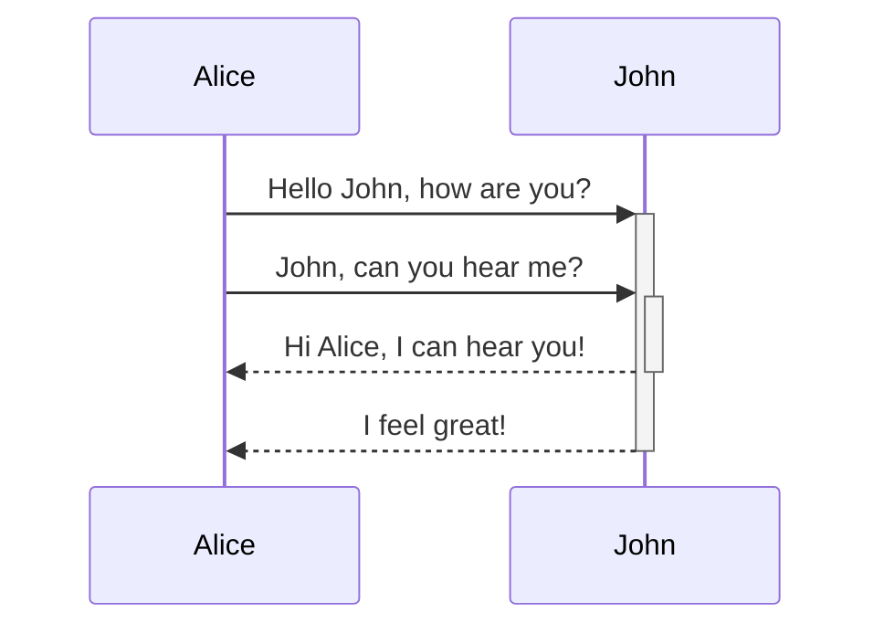

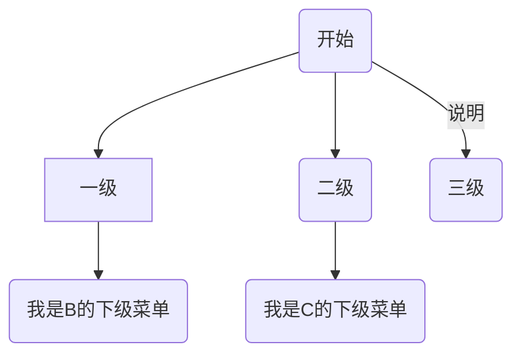

## 序列图/Sequence
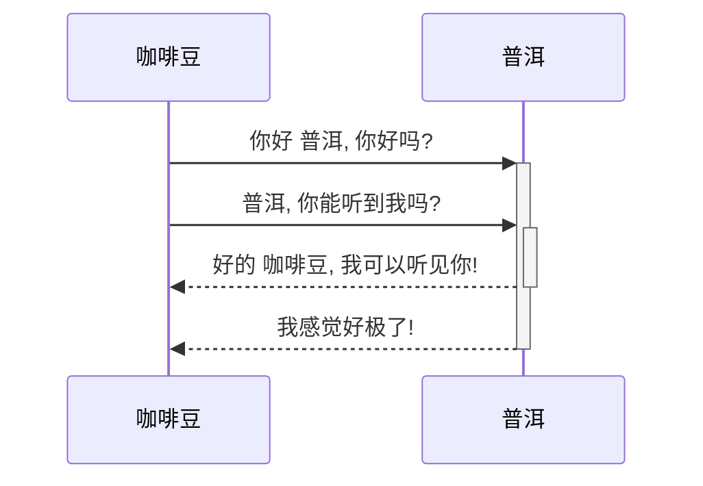

## 甘特图/Gantt
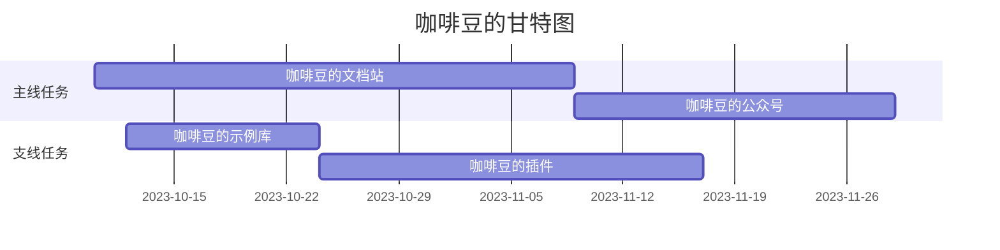

## class 类图
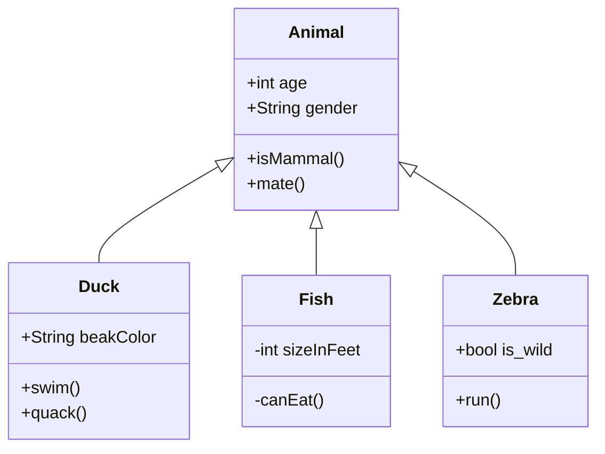

## ER 图
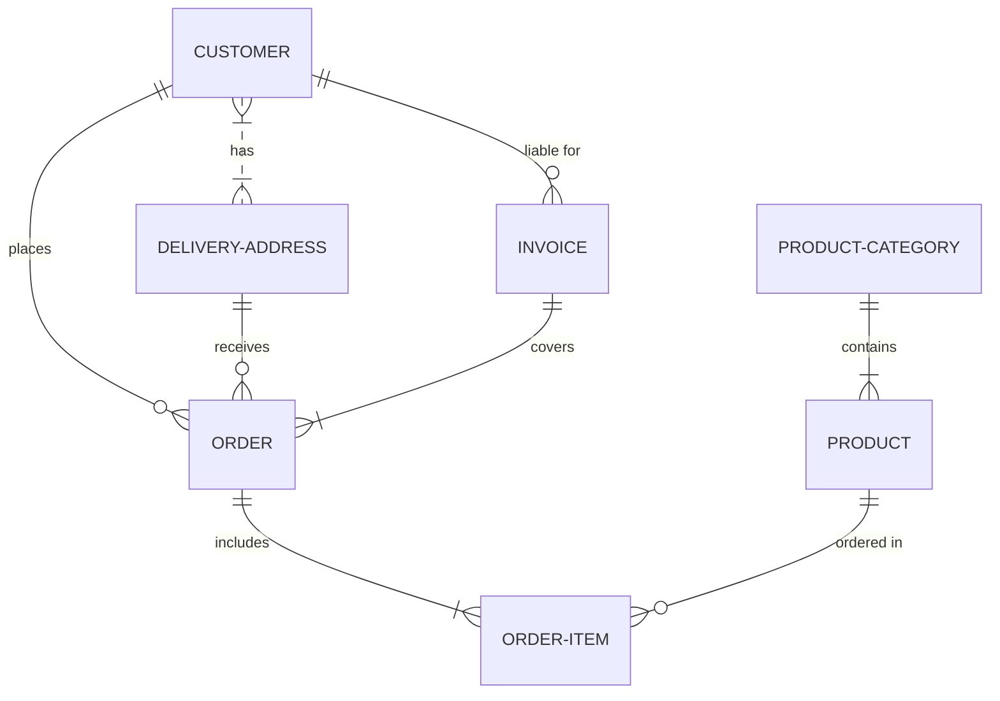

## 5 mindmap 导图
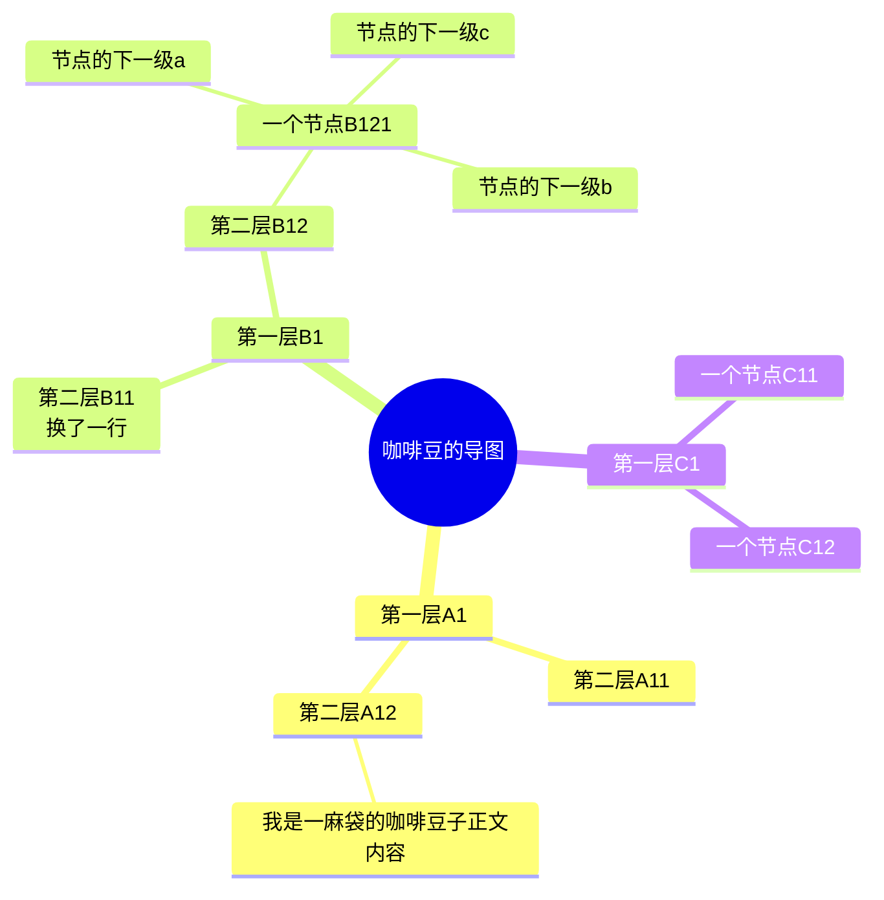
## 百分比饼图 pin
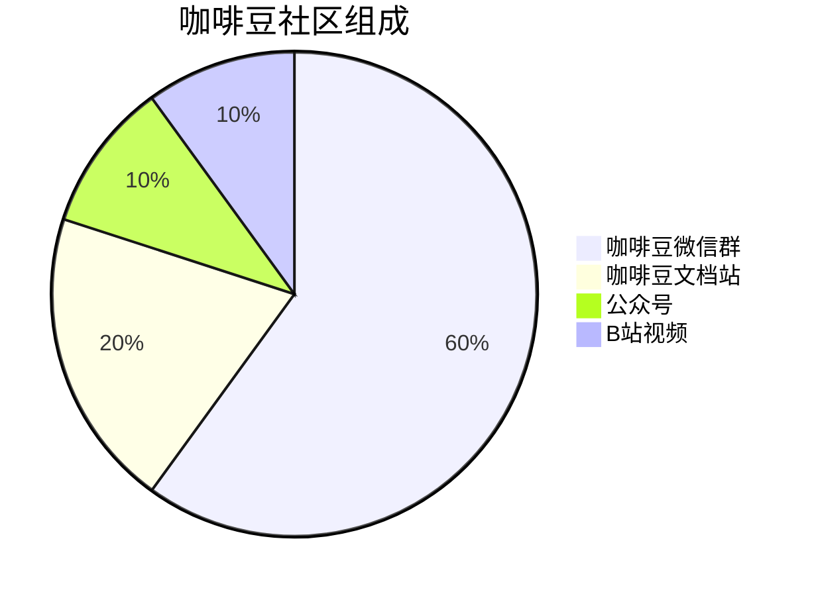
## 四象限图
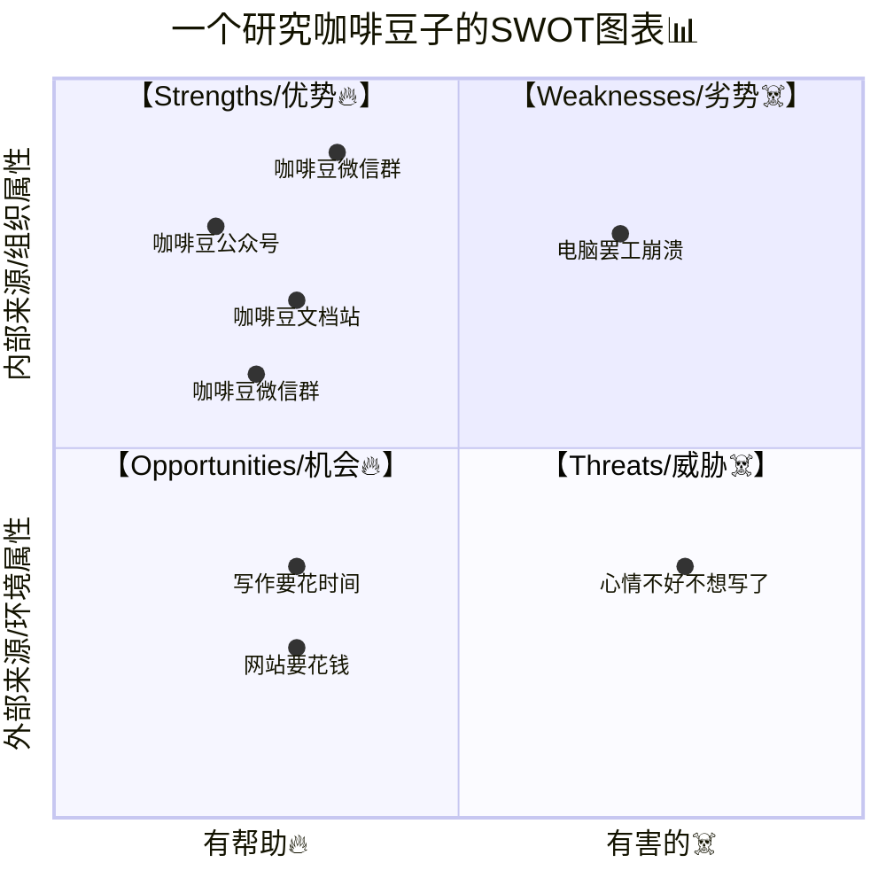
## 时间轴
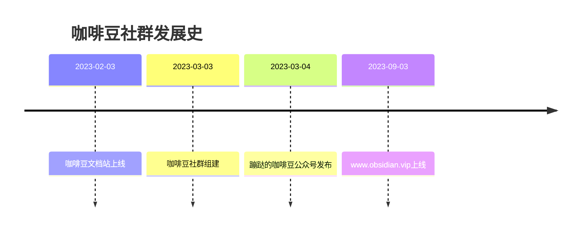
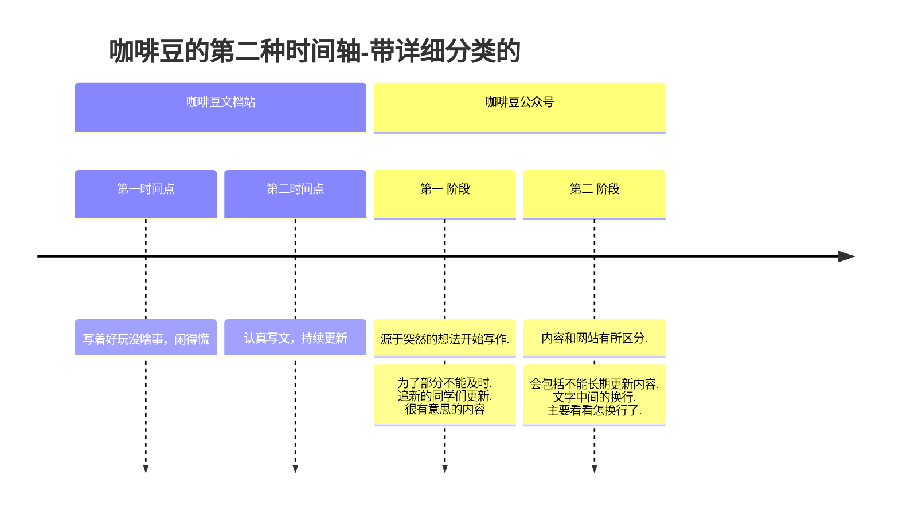

## git
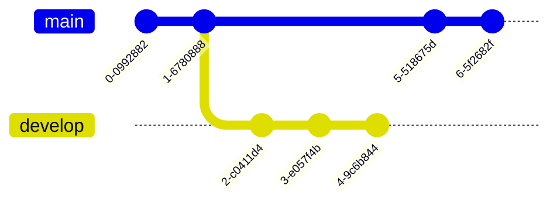
## state 图
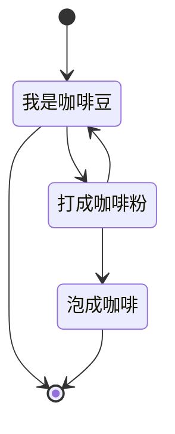
