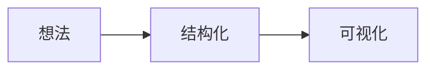
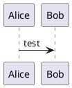
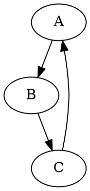
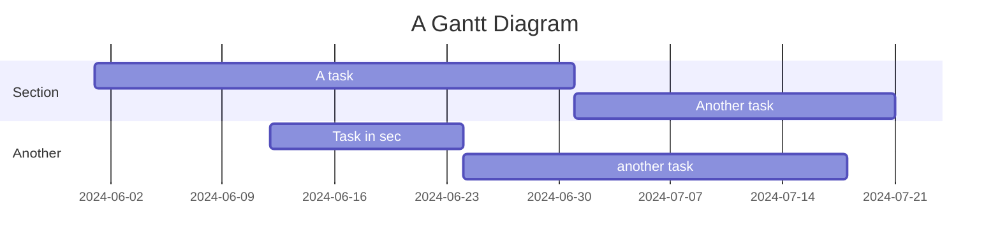

# Obsidian 有哪些绘图功能

> [!note] 使用建议
> 原生优先使用 Mermaid、Canvas 和数学公式；更复杂的 UML、手绘图或交互式图表再考虑插件扩展。

Obsidian 支持多种不同的语言和格式来创建和嵌入图表、绘图和其他内容。包括 Mermaid 在内，下面整理几种常见能力和扩展方式：

### Mermaid
Obsidian 原生支持 Mermaid，适合流程图、时序图、甘特图、状态图等文本化图表。



### 1. LaTeX
Obsidian支持LaTeX数学公式，可以用来书写复杂的数学表达式。使用双美元符号（`$$`）来包围 LaTeX 代码。例如：

```markdown
$$
E = mc^2
$$
```
$$E=mc^2$$
### 2. PlantUML
Obsidian 可以通过插件支持 PlantUML 来创建 UML 图，例如类图、序列图等。需要安装相关插件并在代码块中使用：




### 3. Graphviz (DOT)
Graphviz 的 DOT 语言可以用来创建图形结构，如流程图、网络图等。需要安装相应的插件：



### 4. Markdown Diagrams (Sequence Diagrams, Flowcharts)
Obsidian 可以通过插件如 `Obsidian Draw.io` 来嵌入并创建 Draw.io 图表。也可以通过 `markdown-diagrams` 一类插件支持简单的序列图和流程图：

#### 序列图：
```sequence
Alice->Bob: Hello Bob, how are you?
Note right of Bob: Bob thinks
Bob-->Alice: I am good thanks!
```

#### 流程图：
```flow
st=>start: Start
e=>end: End
op=>operation: My Operation
cond=>condition: Yes or No?

st->op->cond
cond(yes)->e
cond(no)->op
```

### 5. Gantt Charts
Obsidian 通过 Mermaid 支持甘特图，用于项目管理和时间线图：



### 6. Dataview
Obsidian 的 Dataview 插件允许用户在 Markdown 文件中嵌入查询和动态内容显示：


```dataview
table date, status
from "projects"
where status = "in-progress"
```

### 7. D3.js
通过一些插件或自定义 HTML，可以在 Obsidian 中嵌入 D3.js 代码来创建复杂的数据可视化。

### 8. Vega-Lite
通过插件支持 Vega-Lite，用于创建数据可视化：

```vega-lite
{
  "data": {
    "values": [
      {"a": "A", "b": 28}, {"a": "B", "b": 55}, {"a": "C", "b": 43}
    ]
  },
  "mark": "bar",
  "encoding": {
    "x": {"field": "a", "type": "ordinal"},
    "y": {"field": "b", "type": "quantitative"}
  }
}
```

### 结论
通过上述多种语言和格式，Obsidian 可以支持用户创建和嵌入多种类型的图表和可视化内容，极大地增强了笔记的表达能力和灵活性。根据需要安装相应的插件，可以进一步扩展能力，实现更复杂的内容展示。
